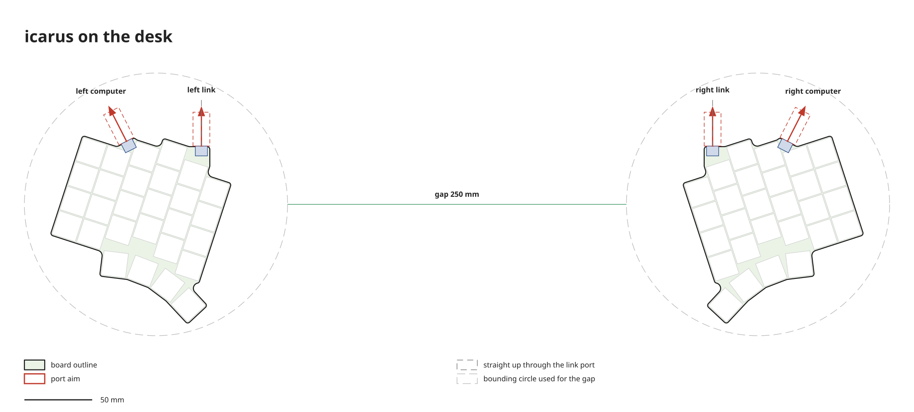
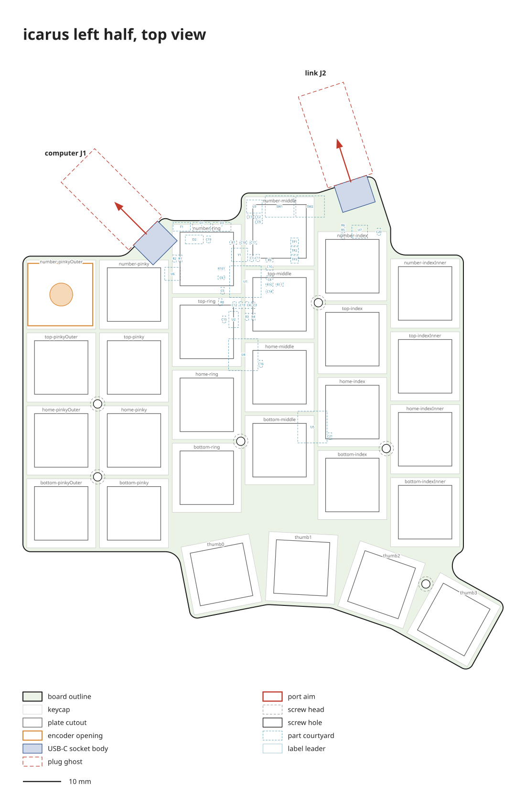

# icarus

Board 1: split, low profile, Hall effect (Gateron LP Magnetic Jade), wired USB-C, 4x6 + 4 thumb keys per half, one knob per half. Learning board, expected to fail.

All numbers are mm. Frame: left half, origin = middle column home key, x toward the thumbs, y down. Right half = mirror. "outer" = toward the pinky, "inner" = toward the other half.

## Files

| file | holds |
|---|---|
| `layout.json` | key positions (layout-fit tool, `tool/layout-fit/`), desk tilt 18 deg inward |
| `board.json` | knob, board outline, USB-C ports, plug, mounting, electronics zone, PCB layer stack |
| `parts.json` | parts with LCSC numbers |
| `channels.json` | key to mux channel, GPIO map |
| `placement.json` | pose of every non-key part |
| `pcb/`, `plate/`, `drawing/` | generated, never edit by hand (`pcb/` placement: `python -m kb.place`, routing: `python -m kb.route [left] [right]`; `drawing/`: `python -m kb.drawing`) |
| `fab/` | generated, git-ignored, JLCPCB order files per half: `<side>-gerbers.zip` (Gerbers + drill), `<side>-bom.csv`, `<side>-cpl.csv` (`python -m kb.fab`). CPL rotation corrections only for SOT-23, TSSOP, HRO USB-C (`JLC_ROTATION_DEG`); check every part in JLC's placement preview before paying |

## Board shape (`board.json`)

- outline hugs the keys: each keycap square (18.05) + 1.0 margin, inner corners radius 4, outer corners radius 2. Plate and bottom cover share it
- knob: rotary encoder with detents on BOTH halves, outermost column, number row
- host USB-C: on a 45 deg slope filling the step from the ring column's top outer corner to the pinky column's top edge, slope pushed out 1.5. Port centred on the slope, aimed 45 deg up and outward (27 deg on the desk)
- link USB-C: on an ear above the index column. Face starts at the middle column's top inner corner, square to an aim of 18 deg outward. The ear's far corner is a right angle, its edge runs straight to the index column's top inner corner. Port slid so the plug edge sits on that corner. Points straight up on the desk
- plug: assumed 12.4 wide, kept >= 1.0 from the board
- the 18 deg desk tilt is what turns the 18 deg link aim into straight up

## Stack

| layer | value |
|---|---|
| plate (transparent) | 1.2 thick, 1.30 above PCB |
| PCB (white, lead-free HASL) | 1.2, 4 copper layers, see below |
| parts | all on the PCB bottom, tallest USB-C 3.3 |
| bottom cover | 3.80 below PCB, needs feet >= 0.5 (plug hangs 0.13 below the cover) |

### PCB layers (`board.json` `pcb`)

JLCPCB 4-layer, 1.2 thick, impedance stack `JLC04121H-7628` (outer copper 1 oz, inner 0.5 oz). Layer thicknesses and dielectric constants are JLCPCB's for that stack; they add up to 1.15 with mask, the fab's nominal is 1.2. Copper finish lead-free HASL (`copperFinish`, KiCad name `HAL lead-free`).

| layer | kind | thickness | role |
|---|---|---|---|
| F.Mask | solder resist, er 3.8 | 0.01524 | |
| F.Cu | copper | 0.035 | signal |
| | prepreg NP-155F 7628, er 4.4 | 0.2104 | |
| In1.Cu | copper | 0.0152 | power: solid GND plane |
| | core NP-155F, er 4.36 | 0.6 | |
| In2.Cu | copper | 0.0152 | signal |
| | prepreg NP-155F 7628, er 4.4 | 0.2104 | |
| B.Cu | copper | 0.035 | signal |
| B.Mask | solder resist, er 3.8 | 0.01524 | |

- `kb.place` writes the layer count, layer roles (KiCad layer type) and this stackup into both boards
- a layer with `plane` gets one zone of that net covering the whole outline, regenerated and refilled on every run like Edge.Cuts. Copper keeps the board's edge clearance; the only gaps are clearances around other nets' holes and pads
- In1.Cu stays one unbroken GND plane under the analog lines, the muxes and the MCU

## Mounting

M2 wafer-head screws (head <= 0.8 tall), 6 per half, right = mirror of left:

- every four-way junction (four keycap corners meet), head hidden under the corners
- one hole in the thumb cluster, between two thumb keycaps where possible; its head may show
- T-junctions (two keycap corners and the side of a third), chosen so every key centre is <= 35 from a hole

Hole centres keep 3.1 from every plate cutout and the board edge, and 2.3 from sensors, their caps and the encoder parts. Check keycap bottom-out clearance once switches arrive; fallback is pan heads beside the keys.

## Electronics

MCU, flash, crystal, muxes and power parts fit inside the outline first. If they do not fit, the outline grows under the two outer columns down to the outermost thumb key.
