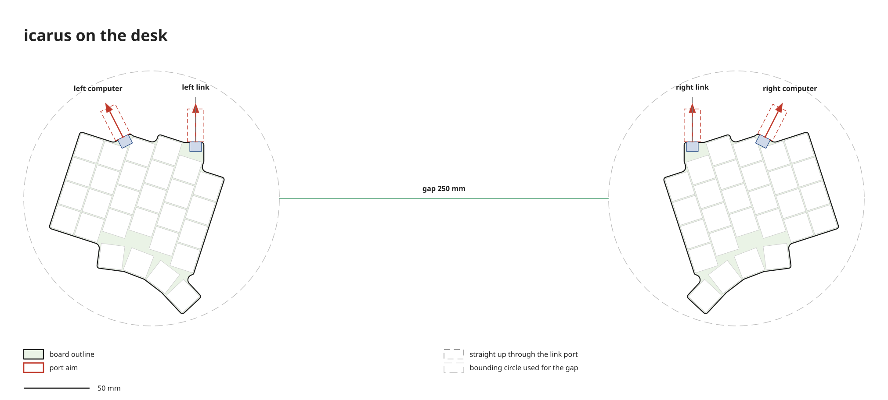
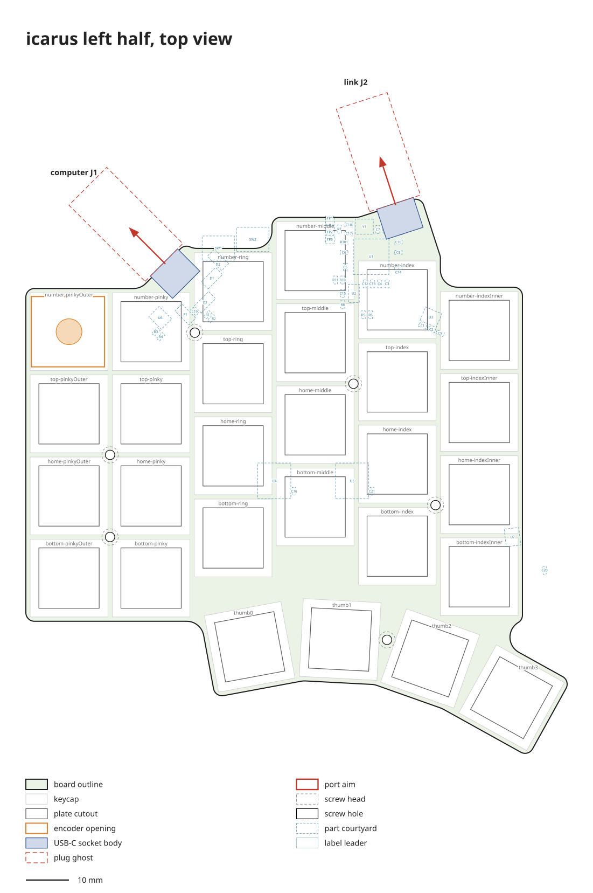

# icarus

Board 1: split, low profile, Hall effect (Gateron LP Magnetic Jade), wired USB-C, 4x6 + 4 thumb keys per half, one knob per half. Learning board, expected to fail.

All numbers are mm. Frame: left half, origin = middle column home key, x toward the thumbs, y down. Right half = mirror. "outer" = toward the pinky, "inner" = toward the other half.

## Files

| file | holds |
|---|---|
| `layout.json` | key positions (layout-fit tool, `tool/layout-fit/`), desk tilt 18 deg inward |
| `board.json` | knob, board outline, USB-C ports, plug, mounting, electronics zone |
| `parts.json` | parts with LCSC numbers |
| `channels.json` | key to mux channel, GPIO map |
| `placement.json` | pose of every non-key part |
| `pcb/`, `plate/`, `drawing/` | generated, never edit by hand (`drawing/`: `python -m kb.drawing`) |

## Board shape (`board.json`)

- outline hugs the keys: each keycap square (18.05) + 1.0 margin, inner corners radius 4, outer corners radius 2. Plate and bottom cover share it
- knob: rotary encoder with detents on BOTH halves, outermost column, number row
- host USB-C: on a 45 deg slope filling the step from the ring column's top outer corner to the pinky column's top edge, slope pushed out 1.5. Port centred on the slope, aimed 45 deg up and outward (27 deg on the desk)
- link USB-C: on an ear above the index column. Face starts at the middle column's top inner corner, square to an aim of 18 deg outward. The ear's far corner is a right angle, its edge runs straight to the index column's top inner corner. Port slid so the plug edge sits on that corner. Points straight up on the desk
- plug: assumed 12.4 wide, kept >= 1.0 from the board
- the 18 deg desk tilt is what turns the 18 deg link aim into straight up

## Stack

| layer | value |
|---|---|
| plate (transparent) | 1.2 thick, 1.30 above PCB |
| PCB (white, silver HASL) | 1.2 |
| parts | all on the PCB bottom, tallest USB-C 3.3 |
| bottom cover | 3.80 below PCB, needs feet >= 0.5 (plug hangs 0.13 below the cover) |

## Mounting

M2 wafer-head screws (head <= 0.8 tall), 6 per half, right = mirror of left:

- every four-way junction (four keycap corners meet), head hidden under the corners
- one hole in the thumb cluster, between two thumb keycaps where possible; its head may show
- T-junctions (two keycap corners and the side of a third), chosen so every key centre is <= 35 from a hole

Hole centres keep 3.1 from every plate cutout and the board edge, and 2.3 from sensors, their caps and the encoder parts. Check keycap bottom-out clearance once switches arrive; fallback is pan heads beside the keys.

## Electronics

MCU, flash, crystal, muxes and power parts fit inside the outline first. If they do not fit, the outline grows under the two outer columns down to the outermost thumb key.
